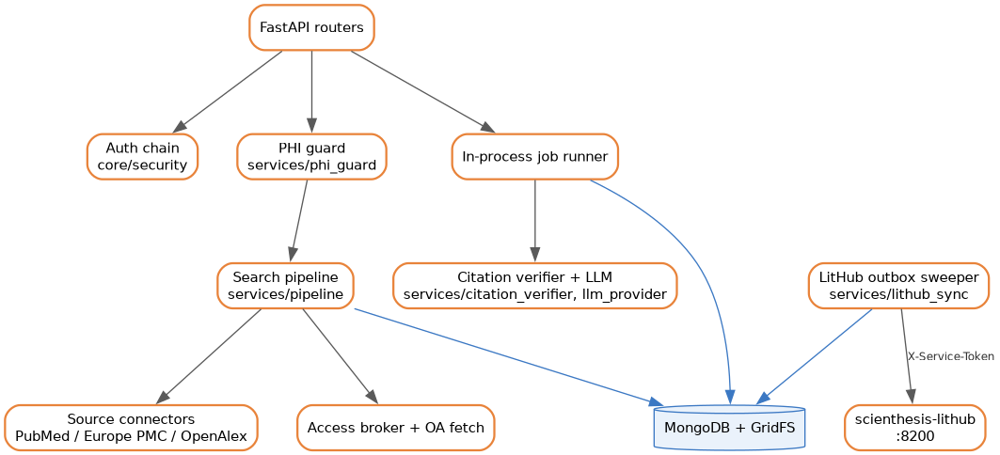
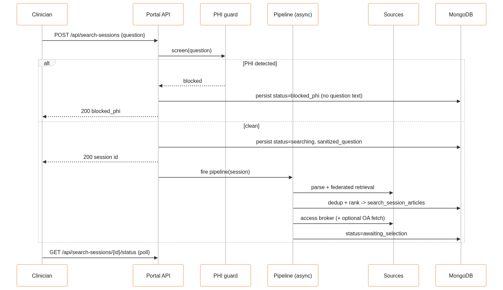

# Architecture

The Portal Engine turns a clinical question into a verified evidence answer through a fixed pipeline. The design principle is broad AI interpretation with deterministic evidence control: models can help read and phrase a question, but they never decide what evidence exists, what ranks where, what the clinician selected, or what a summary is allowed to cite. Retrieval, ranking, selection, and the citation floor are deterministic code paths. The AI sidecars are advisory and default off.

## Overview

A request enters through FastAPI routers. Authenticated write paths for a search session run the PHI guard first, then hand off to the pipeline, which drives the session through a status machine persisted in Mongo. Summary generation and OA full-text fetch run as background jobs. Library writes are mirrored to LitHub through a durable outbox that a startup task sweeps.

## Request lifecycle: search session

Creating a session is one authenticated `POST`. The heavy work runs as a fire-and-forget task, and the client polls status. The status machine is `draft → blocked_phi | searching → ranking → brokering_access → (fetching_oa_full_text) → awaiting_selection → summarizing → complete | error`.

The PHI guard runs before persistence and before any external call. A blocked session stores `status=blocked_phi` with `sanitized_question=NULL` and never retains the raw question. Retrieval fans out to PubMed, Europe PMC, and OpenAlex plus guideline and Cochrane lanes, capped by `PUBMED_MAX_RESULTS_PER_QUERY` and the concurrency limits. Dedup collapses records on `canonical_key` and the partial-unique `pmid` / `doi` / `pmcid` keys. The access broker resolves open-access status and, if `OA_FETCHER_ENABLED` is on and the license passes the gate (`OA_ALLOW_*`), fetches full text. The session then holds at `awaiting_selection`.

## Request lifecycle: summary with citation floor

The summary stage is separate and gated. No model text reaches the clinician until an independent verifier confirms the claim map.

1. The clinician selects articles (`POST /api/search-sessions/{id}/articles/{aid}/include-override` and the selection routes). Selection is the human decision that defines the evidence set. Nothing else can add or reorder it.
2. `POST /api/search-sessions/{id}/generate-summary` enqueues a summary job. The runner is capped by `MAX_CONCURRENT_SUMMARY_JOBS` and `MAX_SELECTED_ARTICLES_FOR_SUMMARY`.
3. The LLM provider (`services/llm_provider`) drafts an answer with a claim-to-citation map over the selected articles only.
4. `services/citation_verifier` checks every claim against its cited source independently of the drafting model. The `summaries` document tracks `verification_status` through `pending → running → passed | failed`.
5. A `passed` summary becomes visible. A `failed` one is blocked, and the session surfaces verification guidance rather than the draft.

The advisory sidecars (`AI_QUERY_CATEGORIZER`, `AI_CONTEXT_AUGMENT`, `AI_EVIDENCE_SURFACING`, and the ranker sidecars in `agents/`) sit outside this path. When enabled they write diagnostics and a separate `ai_surfaced_articles` shelf that is never merged into the ranked set or the selection.

## Data model

MongoDB, roughly 35 collections. `core/db.py` owns the `Collections` registry and `ensure_indexes`. The important ones:

| Collection | Key fields | Notes |
|---|---|---|
| `users` | `id`, `email` unique, `hashed_password`, `role` (`user`\|`admin`), `identity_id` sparse (`sub`), `litpulse_user_id`, `first_use_acknowledged` | `identity_id` links a lazily provisioned Identity shadow user |
| `search_sessions` | `status`, `sanitized_question` (NULL when `blocked_phi`), `expires_at` | Central state machine; 30-day TTL |
| `search_queries` | `planner_source` | Planner provenance for transparency |
| `articles` | `canonical_key` unique, partial-unique `pmid`/`doi`/`pmcid`, `is_retracted`, `has_expression_of_concern` | Canonical article records |
| `search_session_articles` | ranked join of session to article | Ranking output |
| `article_access_locations` | `license`, `can_ingest_for_summary` | Access-broker output |
| `summaries` | `answer_json`, `verification_status`, `claim_map_json` | One per generated summary |
| `evidence_packets` | unique per session, branch-aware, leak-scanned | Selection metadata only; never raw evidence text |
| `jobs` | durable async job records | Summary and OA-fetch work |
| `folders` / `folder_articles` | user-owned organization | |
| `user_library_items` | unique `(user_id, article_id)` active | Mirrored to LitHub |
| `research_collections` / `research_collection_items` | hierarchical, `paper_id` = LitHub id | Mirrored |
| `source_configs` | per-source enable, seeded at startup | |
| `guideline_sources` | K5 registry, `ai_ingestion_allowed` hard false for all | |
| `uploaded_full_text_assets` / `article_text_extracts` | TTL, checksum, GridFS pointer | Uploaded PDFs live in GridFS |
| `audit_events` | append-only | |
| `lithub_sync_outbox` | `op` (`save`\|`delete`), `payload.user_id` (`sub`), `status`, `attempts` | Durable dual-write queue |
| `ai_agent_decisions` / `ai_surfaced_articles` | TTL 30d | Advisory only |

Uploaded PDFs are stored in GridFS through an `AsyncIOMotorGridFSBucket` (`services/user_uploaded_full_text.py`), not inline in a document. Evidence packets record which articles the clinician selected and the branch structure, not the article text.

## Integration contracts

### Authentication

`core/security.get_current_user` resolves a bearer token through a flag-gated chain:

1. **Native HS256** signed with `JWT_ACCESS_SECRET`. This is byte-identical to the original Emergent behavior when both integration flags are off.
2. **Identity RS256** verified offline against the JWKS cached from Identity (`iss=scienthesis-identity`, `aud=litportal`). On first contact a shadow user is provisioned in Mongo keyed by the token `sub`. Active only when `LITPORTAL_USE_IDENTITY=true`.
3. **Legacy LitPulse HS256** when `LITPULSE_JWT_ENABLED=true`, using `LITPULSE_JWT_SECRET_KEY`.

Admin routes require `role == "admin"` (`core/security.require_admin`). Refresh tokens ride in the httponly `ces_refresh_token` cookie.

### Service tokens

Outbound calls to Identity and LitHub `/internal/*` endpoints carry an `X-Service-Token`: an HS256 JWT with `iss=litportal`, signed with `SERVICE_TOKEN_SECRET` (`clients/service_token.py`). The secret must be byte-identical across all four services. Minting raises `RuntimeError` if the secret is unset, so the integration path fails loudly rather than sending an unsigned request.

### Dual-write to LitHub

Library saves and deletes never call LitHub inline. The write path enqueues a row in `lithub_sync_outbox` in the same request, and the sweeper drains it. Each payload is keyed by the Identity `sub`, so a paper saved from LitPortal or LitPulse collapses to one LitHub entry. The mirror targets `/api/v1/internal/library/save`, `/membership`, `/bulk-import`, and `/papers/bulk`. The whole path is a no-op unless `LITPORTAL_DUAL_WRITE_LITHUB=true` and `LITHUB_BASE_URL` is set.

## Security and privacy

- **PHI.** A deterministic regex guard (`services/phi_guard`) screens every question before persistence and before any external call. A blocked session keeps no question text. This is beta and the guard is pattern-based, not a model, so treat it as a first-line control, not a compliance boundary.
- **Evidence isolation.** Evidence packets store selection metadata and are leak-scanned. Raw source text is not copied into them. `guideline_sources.ai_ingestion_allowed` is hard-set false for every entry, so guideline text is never fed to a model.
- **Passwords and sessions.** Passwords are bcrypt. Refresh tokens are opaque and delivered in an httponly cookie. Failed logins are rate-limited in memory at `LOGIN_RATE_LIMIT_MAX` per email and IP.
- **Secrets.** `JWT_ACCESS_SECRET` and `JWT_REFRESH_SECRET` auto-generate per process when unset. That is fine for a single dev process and unsafe anywhere with more than one worker or a restart, because every issued token dies with the process. Set them from a secret store in staging and production, along with `SERVICE_TOKEN_SECRET` and the provider keys.
- **CORS.** `_resolve_cors_origins` reads `CORS_ORIGINS`, drops a bare `*` (incompatible with `allow_credentials=True`), and falls back to a hardcoded operator allowlist. The allowlist still carries the original Emergent preview and production origins; update it for a new deployment.
- **Uploads.** `PDF_UPLOAD_ALLOW_WITHOUT_AV` defaults true. In production, set it false and configure a scan mode before exposing the upload routes.

## Background jobs

Four asynchronous concerns run inside the process:

- **LitHub outbox sweeper.** An asyncio loop started in the lifespan (`services/lithub_sync.outbox_sweeper_loop`), 60-second interval, exponential backoff at 1/2/4/8/16 minutes, five attempts before a row is marked `dead`. It is a no-op unless dual-write is on and `LITHUB_BASE_URL` is set.
- **In-process job runner.** Runs summary and OA-fetch jobs from the `jobs` collection under `MAX_CONCURRENT_SUMMARY_JOBS` and `MAX_CONCURRENT_OA_FETCH_JOBS`, with a stale sweep at `JOB_STALE_AFTER_MINUTES`. `JOB_RUNNER_MODE` defaults to `in_process`.
- **Search pipeline.** Fired per session as a background task after PHI screening, driving `searching → ranking → brokering_access → (fetching_oa_full_text) → awaiting_selection`.
- **Startup seeders and retention.** Seed `source_configs` and `guideline_sources` idempotently, and TTL indexes expire sessions and the shadow sidecar collections at 30 days.

Because the runner and the sweeper live in the app process, work is bounded to a single task's capacity and does not survive a task restart mid-job (the stale sweep re-picks abandoned jobs). Moving to an external queue is the natural next step, called out below.

## AWS deployment

The service is a stateless container plus MongoDB, which maps onto Fargate cleanly.

| Concern | AWS service | Notes |
|---|---|---|
| Compute | ECS on Fargate | Run `server:app` from the image. Multiple tasks are fine once secrets are externalized. |
| Ingress | Application Load Balancer | Health check `GET /api/health`. Terminate TLS at the ALB and set `COOKIE_SECURE=true`. |
| Database | DocumentDB, or self-managed MongoDB / Atlas | Atlas is the tested target. DocumentDB needs validation of the partial-unique indexes, TTL indexes, and GridFS before it is a drop-in. |
| Uploaded full text | S3 (future) | Today PDFs live in Mongo GridFS. S3 is the target for offloading binaries; the boto3 dependency is already present. |
| Outbox and jobs | SQS + EventBridge (future) | The outbox and job runner are in-process today. SQS for the outbox and an EventBridge-scheduled runner would decouple them from the web tasks. |
| Secrets | Secrets Manager | `JWT_ACCESS_SECRET`, `JWT_REFRESH_SECRET`, `SERVICE_TOKEN_SECRET`, `MONGO_URL`, and provider keys. The service-token secret must be identical to the value the other three services read. |

Two things to get right before scaling out tasks. First, set the JWT secrets and `SERVICE_TOKEN_SECRET` explicitly; the per-process auto-gen breaks token validation across tasks. Second, the login rate limiter and the JWKS cache are per-task in-memory, so their effect is per-task under a load balancer. Neither is a correctness problem for auth; both are worth knowing when reading metrics.

## Known limitations and operational notes

- Run from the repo root as `server:app`. The tree uses top-level imports, not a package, so `backend.server:app` or a different working directory fails to import.
- `MONGO_URL` and `DB_NAME` are read with no default and raise `KeyError` at import if missing.
- JWT secrets auto-generate per process when unset. Set them in any multi-worker or restart-surviving environment.
- Both integration flags default off, which gives byte-identical standalone native auth. Turning them on requires the base URLs and a shared `SERVICE_TOKEN_SECRET` across all four services.
- Module mount is on by default, so every route is registered twice (once under `/api`, once under `/api/litportal`), which doubles the OpenAPI surface. Turn off `LITPORTAL_MODULE_MOUNT_ENABLED` for a standalone deployment if the duplicate paths are noise.
- Environment naming has live foot-guns: the OpenAlex connector reads `OPENALEX_MAILTO` (not `OPENALEX_EMAIL`), Crossref is split across `CROSSREF_MAILTO` and `CROSSREF_EMAIL`, and PubMed accepts either `NCBI_API_KEY` or `PUBMED_API_KEY`.
- `LLM_PROVIDER=emergent` needs an on-platform package that is commented out of `requirements.txt` and unreachable off-platform. Use `openai`, `openrouter`, or `anthropic` on AWS.
- The production startup guards for the cap-enforcement, M3, and M4 stages fail closed. An unsafe active flag combination without the fingerprint gates crashes boot by design. Leave those stages at their defaults.
- Roughly 122 files under `services/` encode phased shadow stages (K2 to K5, M3 to M4, R1A to R1C) that are mostly default-off or `shadow`. The live path is PHI → parse → retrieve → rank → broker → optional OA fetch → `awaiting_selection` → optional summary with verification. The rest is instrumentation and staged work, not the request path.
- Uploads default to allowing files without an AV scan (`PDF_UPLOAD_ALLOW_WITHOUT_AV=true`). Set it false in production.
