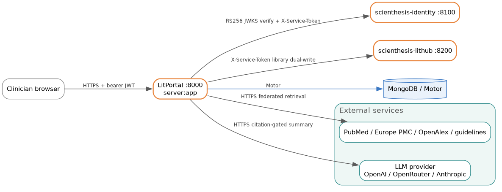

# LitPortal Backend (Portal Engine)

Clinician-facing evidence search and citation-verified synthesis. Takes a natural-language clinical question, screens it for PHI, federates retrieval across the medical literature, and produces an answer that no LLM is allowed to write until an independent verifier confirms every claim maps to a selected source.

## What it does

- Screens each question for protected health information with a deterministic guard that runs before anything is persisted or any external call is made. A blocked question is stored as `blocked_phi` with no question text retained.
- Parses the question (PICOTT / clinical-question-map) and federates retrieval across PubMed, Europe PMC, and OpenAlex, plus guideline and Cochrane lanes.
- Dedups and ranks the candidate set, then brokers open-access status through Unpaywall, Crossref, and Semantic Scholar and optionally fetches OA full text under a license gate.
- Holds the session at `awaiting_selection` so the clinician chooses which articles count. The evidence set is a human decision, not a model output.
- Generates an LLM summary only after selection, and only if an independent citation verifier passes. A failed verification blocks display.
- Runs advisory AI sidecars (query categorizer, context augmentation, evidence surfacing) default OFF. When on, they emit diagnostics and a separate shelf. They never call sources, reorder results, select articles, or cite.
- Keeps a local Mongo library and, when the integration flag is on, mirrors saves and deletes into the shared LitHub library through a durable outbox.

The engine was extracted from the Emergent "ClinEvidence Search API" and adapted to run standalone or as a module inside the LitPulse platform. It is beta. Both Scienthesis integration flags default off, so out of the box it runs as a self-contained app with native auth.

## Where it sits

Portal is one of four Scienthesis backends. Identity owns accounts and signs user tokens. LitHub is the shared library. LitPulse is the consumer-facing sibling. Portal delegates auth to Identity and mirrors library saves to LitHub, both behind default-off flags, and runs its own retrieval and synthesis against the external literature.



## What it provides to other services

- Identifies itself as `iss=litportal` on service-to-service calls, an issuer both Identity and LitHub accept.
- Mounts every router a second time under `/api/litportal/*` when `LITPORTAL_MODULE_MOUNT_ENABLED` is true (the default), so LitPulse can host it as a module.
- Writes library saves and deletes into LitHub keyed by the Identity `sub`, through the `lithub_sync_outbox` collection.
- Exposes `GET /api/health` and, under module mount, `GET /api/litportal/health` as liveness probes.

## What it depends on

- **scienthesis-identity** for JWKS (RS256 verification), delegated auth, and internal user lookup, gated by `LITPORTAL_USE_IDENTITY`.
- **scienthesis-lithub** for the internal library API (`/api/v1/internal/library/save`, `/membership`, `/bulk-import`) and `/papers/bulk`, gated by `LITPORTAL_DUAL_WRITE_LITHUB`.
- **MongoDB** (Atlas in production) for all persistence, including GridFS for uploaded PDFs.
- **External literature APIs**: NCBI PubMed E-utilities, Europe PMC, OpenAlex, NIH iCite, and the OA brokers (Unpaywall, Crossref, Semantic Scholar).
- **An LLM provider** for summary and verification. The provider is pluggable (`openai`, `openrouter`, `anthropic`, or `emergent`); `emergent` needs an on-platform package that is not available off-platform.
- **A shared `SERVICE_TOKEN_SECRET`** that must be byte-identical across all four services, or every service-to-service call fails.

## Stack

- Python 3.12, FastAPI / Starlette / Uvicorn
- Motor / PyMongo against MongoDB, ~35 collections
- Pydantic v2 for request and document models
- PyJWT for both native HS256 tokens and Identity RS256 / JWKS verification
- httpx for all outbound HTTP, one shared client created at startup
- Packaged with `uv`; multi-stage Docker image running as a non-root user

## Repository layout

```
.
├── server.py            ASGI entry (server:app): lifespan, router registration, CORS
├── core/                config.py (Settings), db.py (Motor client, Collections, ensure_indexes), security.py (auth chain)
├── routers/             25 FastAPI routers: auth, search_sessions, summary, oa_fetcher, library, folders, uploads, admin, ...
├── services/            100+ modules: pipeline, phi_guard, citation_verifier, llm_provider, lithub_sync, access broker, source connectors, shadow stages
├── clients/             identity_client.py, lithub_client.py, service_token.py (HS256 X-Service-Token minting)
├── models/              Pydantic v2 documents: sessions, articles, evidence_packets, library, jobs, ...
├── agents/              advisory AI sidecars (query_categorizer, evidence_curator, parallel_search), default OFF
├── scripts/             benchmark seed corpora and QA tooling, not part of the runtime
├── static/              static assets
├── tests/               pytest suite (pytest-asyncio + xdist)
├── Dockerfile           multi-stage build, non-root, healthcheck on /api/health
├── docker-compose.yml   local stack: app + MongoDB, integration flags off
├── requirements.txt     pinned deps (emergentintegrations and litellm commented out)
└── .env.example         full env surface (~90 vars) with naming foot-guns documented
```

The tree imports its siblings as top-level modules, not as a package. Run the app from the repo root as `server:app`, never `backend.server:app`.

## Running it

Local, standalone, with a reachable Mongo:

```bash
cp .env.example .env         # set MONGO_URL and DB_NAME at minimum
uv sync
uvicorn server:app --host 0.0.0.0 --port 8000
```

Or bring up the app plus MongoDB with `docker compose up --build`. `MONGO_URL` and `DB_NAME` are mandatory; the process raises a `KeyError` at import if either is missing. See [SETUP.md](SETUP.md) for the full environment reference and failure modes.

## Documentation

- [SETUP.md](SETUP.md) — prerequisites, local and Docker run, environment variables, health check, tests, failure modes.
- [ARCHITECTURE.md](ARCHITECTURE.md) — pipeline lifecycle, data model, integration contracts, security and PHI model, background jobs, AWS deployment mapping.
